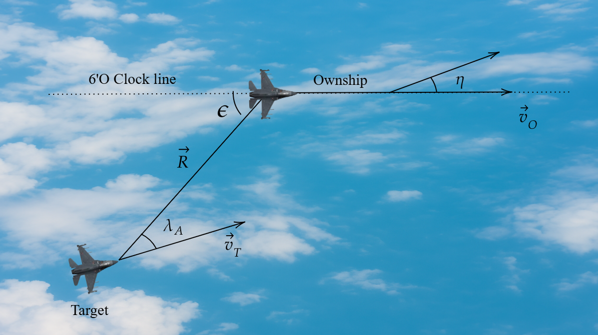
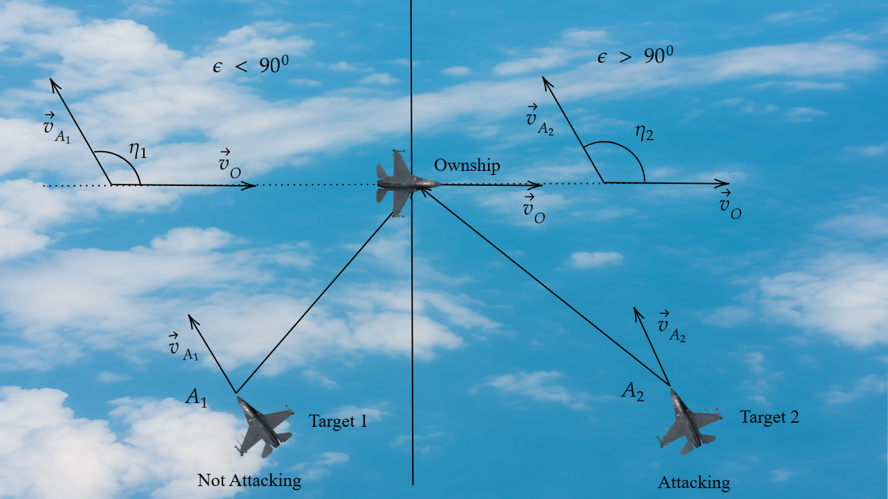
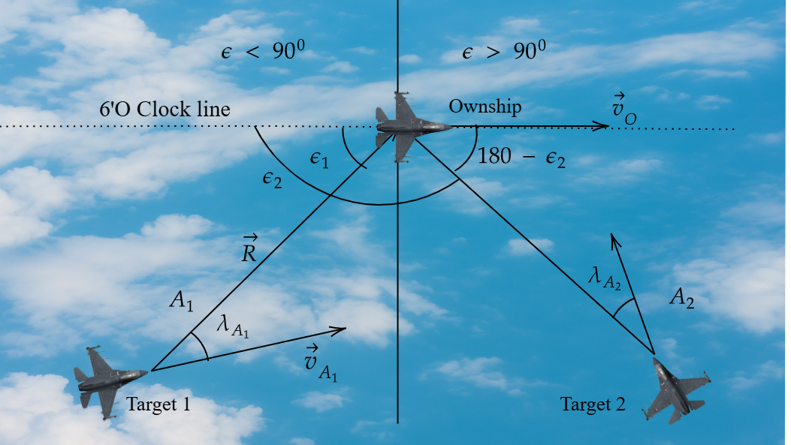
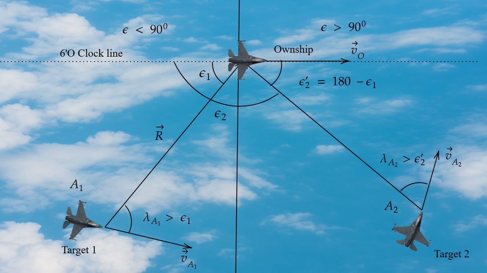
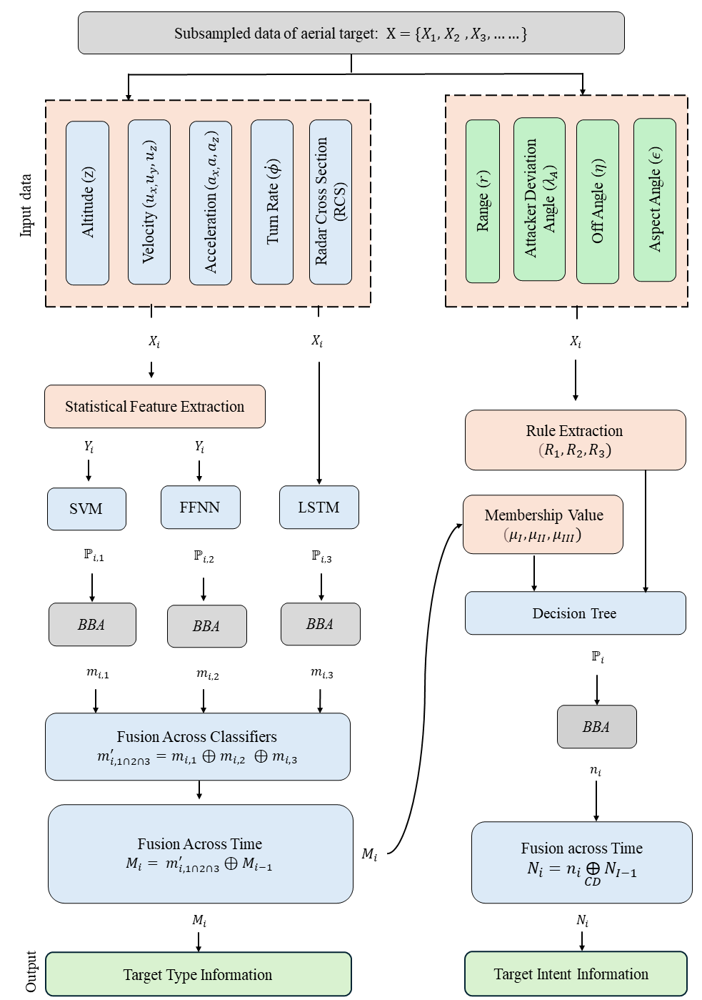
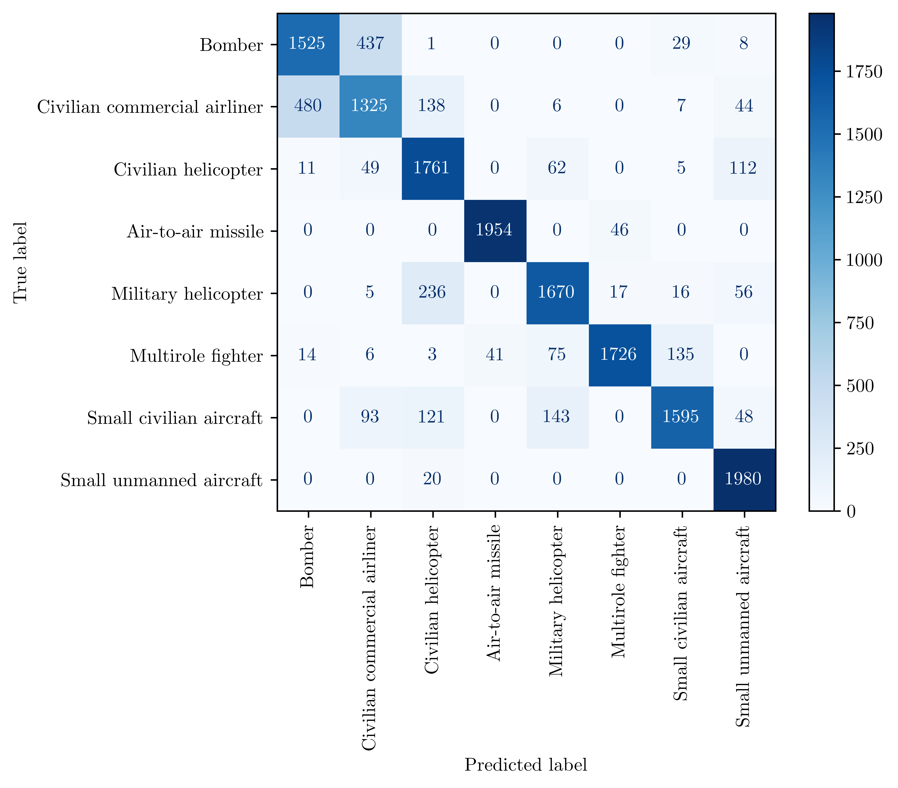
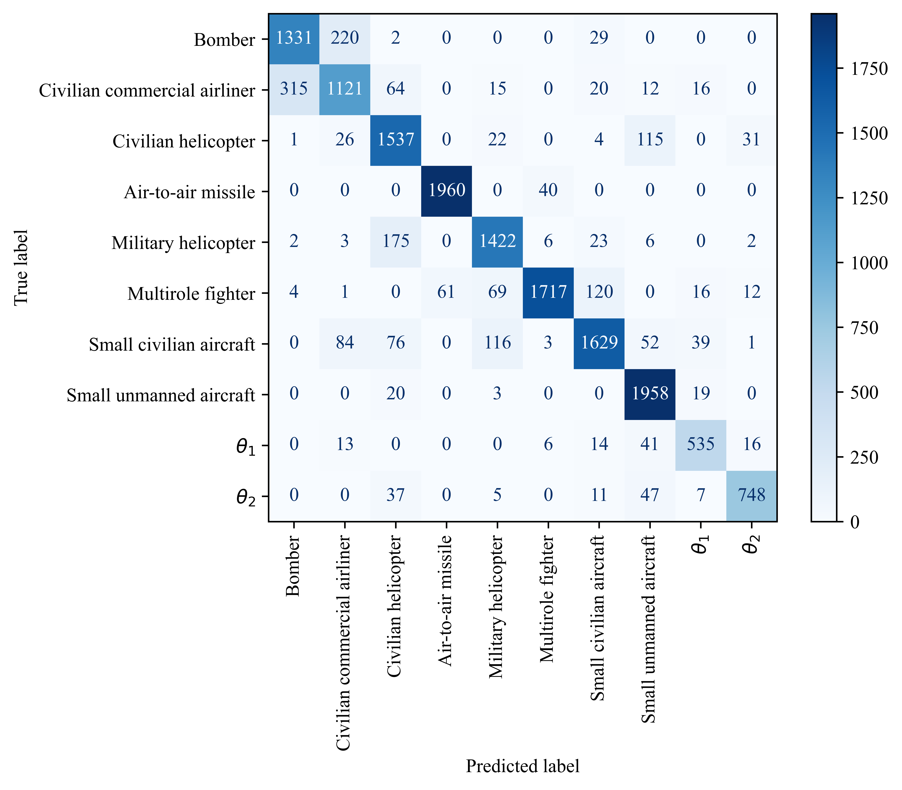
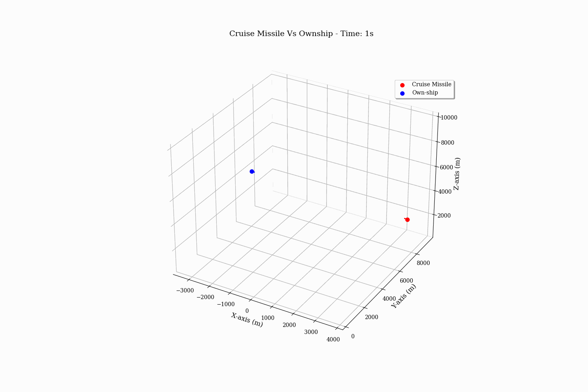
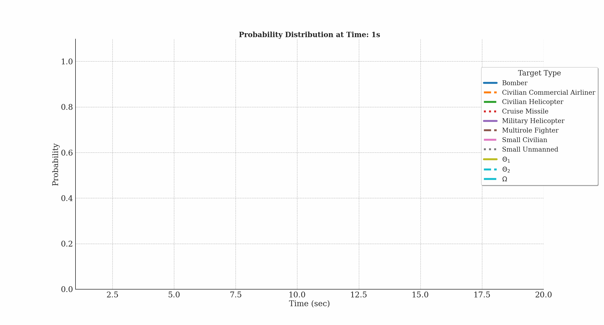
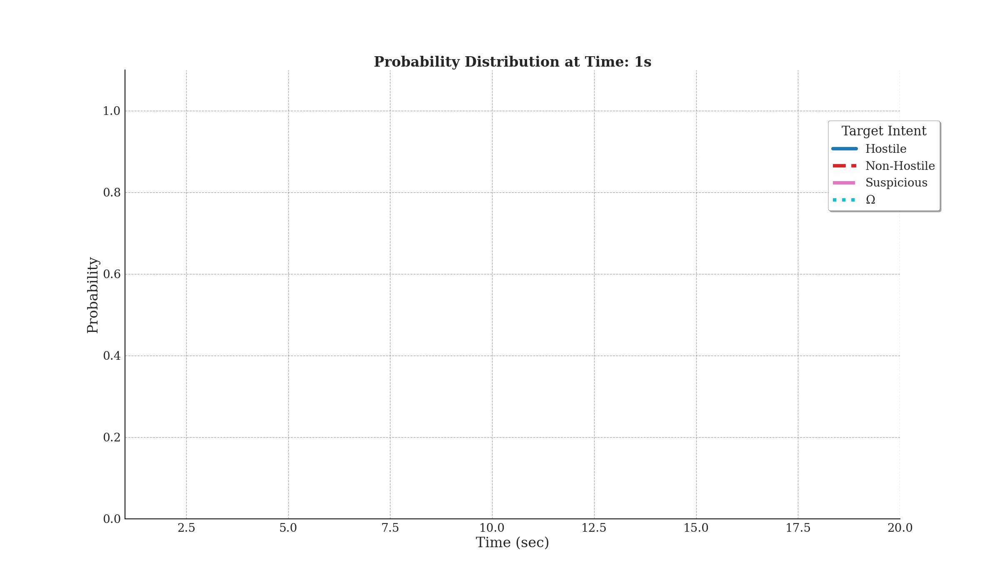

# 🎯 Evidential Reasoning for Aerial Target Classification & Intent Prediction

> **Rapid, uncertainty-aware classification of aerial threats from partial time-series data using Dempster-Shafer evidential reasoning.**

[](https://python.org)
[](https://tensorflow.org)
[](LICENSE)
[]()
[]()

---

## 📖 Abstract

Timely classification and intent prediction of aerial targets is crucial for a combat aircraft to make informed tactical decisions. The prevailing approach relies on data-driven models using time-series data — performing well with long-duration inputs, but this is impractical in rapidly evolving combat situations that demand quick decisions.

**Minimizing false predictions is essential**: uncertainty is preferable to incorrect assessments in high-risk environments.

We propose an **integrated approach** that enables decisions from partial data:

- Predictions are generated from **short sequential sub-samples** instead of the entire time series
- Results are refined by **propagating beliefs across sub-samples**
- Classifier outputs are combined through an **evidential reasoning framework** to manage uncertainty
- Target intent is inferred using **rule-based techniques** and a **distance-based fusion method**

A case study involving **8 aerial targets** achieves:

| Task | Accuracy |
|------|----------|
| Target Type Classification | **88%** |
| Intent Prediction | **93%** |

---

## 🗂️ Table of Contents

- [Combat Geometry](#-combat-geometry)
- [System Overview](#-system-overview)
- [Results](#-results)
- [Demo](#-demo)
- [Installation](#-installation)
- [Usage](#-usage)

---

## ⚔️ Combat Geometry

The approach models the 3D geometry of aerial engagements. Four key conditions define the tactical state between an ownship and a target.

<table align="center">
  <tr>
    <td align="center">
      
      <br><sub><b>(a) Combat Geometry</b></sub>
    </td>
    <td align="center">
      
      <br><sub><b>(b) Angle-Off Condition</b></sub>
    </td>
  </tr>
  <tr>
    <td align="center">
      
      <br><sub><b>(c) Lambda Condition 1</b></sub>
    </td>
    <td align="center">
      
      <br><sub><b>(d) Lambda Condition 2</b></sub>
    </td>
  </tr>
</table>

---

## 🧠 System Overview

<p align="center">
  
</p>

## 📊 Results

Confusion matrices for the two evidential combination rules evaluated:

<table align="center">
  <tr>
    <td align="center">
      
      <br><sub><b>(a) Dempster Rule of Combination</b></sub>
    </td>
    <td align="center">
      
      <br><sub><b>(b) Yager Modified Dempster Combination</b></sub>
    </td>
  </tr>
</table>

The Yager modification handles conflicting evidence more gracefully, redistributing conflict mass to the ignorance set rather than causing counter-intuitive normalizations.

---

## 🎬 Demo

Online classification and intent prediction for a **Cruise Missile vs. Ownship** engagement:

<table>
  <tr>
    <td rowspan="2" width="55%" align="center">
      
      <br><sub><b>(a) Cruise Missile vs Ownship</b> — 3D trajectory simulation</sub>
    </td>
    <td width="45%" align="center">
      
      <br><sub><b>(b) Online target type classification</b> — belief updates per sub-sample</sub>
    </td>
  </tr>
  <tr>
    <td align="center">
      
      <br><sub><b>(c) Online target intent prediction</b> — fused intent estimate over time</sub>
    </td>
  </tr>
</table>

---

## 🛠️ Installation

### Prerequisites

- Windows 10/11 (64-bit)
- NVIDIA GPU with CUDA support (optional but recommended)
- [Anaconda Navigator](https://www.anaconda.com/download)

### Step-by-Step Setup

**1. Create and activate a virtual environment**

```bash
conda create --name tf_gpu python=3.8
conda activate tf_gpu
```

**2. Install GPU support (CUDA & cuDNN)**

```bash
conda install -c conda-forge cudatoolkit=11.2 cudnn=8.1.0
```

**3. Install TensorFlow**

```bash
python -m pip install "tensorflow<2.11"
```

**4. Verify GPU detection**

```bash
python -c "import tensorflow as tf; print(tf.config.list_physical_devices('GPU'))"
```

A non-empty list confirms GPU support is active.

**5. Install remaining dependencies**

```bash
pip install notebook joblib scikit-learn pandas matplotlib seaborn
pip install -U aeon[all_extras]
```
**6. Data downloader libraries**
```bash
pip install gdown
```
---
Access to ttrajectory data can be given on request.

## 🚀 Usage

Launch the Jupyter notebook environment:

```bash
conda activate tf_gpu
jupyter notebook
```

Open the relevant notebook and follow the inline instructions to run classification and intent prediction on the provided dataset.

---

## 📁 Repository Structure

```
├── images/                  # Figures, GIFs, and diagrams used in README
├── notebooks/               # Jupyter notebooks for experiments
├── data/                    # Generated aerial target dataset
├── models/                  # Saved classifier models
├── src/                     # Core source code
│   ├── preprocess/          # Preprocss the input data
│   ├── model_training/      # Train all model 
│   └── postprocess/         # Data fusion 
    └── optimize/            # Optimization
├── output/                  # store all generated output
└── README.md
```

---

## 📄 Citation

If you use this work, please cite - In-Progress

```bibtex
@article{,
  title   = {An Evidential Reasoning Approach for Aerial Target Classification and Intent Prediction},
  journal = {[]},
  year    = {}
}
```

---

## 📬 Contact

For questions or collaborations, please open an issue or reach out via the repository discussions tab.
